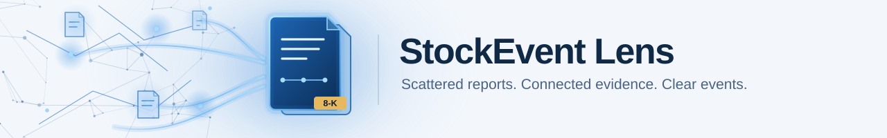
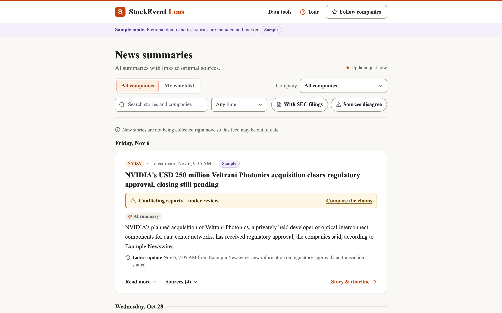

## SECTION 1 : PROJECT TITLE
## StockEvent Lens

*The news feed, shown with the fictional sample story from the test suite (sample mode). The system architecture is
in [SystemCode/README.md](SystemCode/README.md).*

---

## SECTION 2 : EXECUTIVE SUMMARY / PAPER ABSTRACT

A single company event, such as an earnings release, a product launch or a lawsuit, is reported by many outlets
within hours. Some reports repeat each other, some add new facts, and some contradict each other. An investor who
follows a company has to read all of them to find out what actually happened.

**StockEvent Lens** groups this coverage into events. It collects SEC EDGAR 8-K filings and Alpaca financial news
in real time, and finds earlier coverage of the same company with embedding and full-text search. Claude then
decides whether each new report repeats, updates, contradicts or differs from an existing event. Every decision
must quote the source text verbatim, or it is downgraded to *uncertain* and never merged. Each event gets a short
summary in which every statement cites its source passages; conflicting reports go to a person for review instead
of being resolved by the model.

On a labelled test set of 125 articles, Claude Sonnet groups articles with a pairwise F1 of 0.925 and labels them
with a macro F1 of 0.869, without a single false merge. A local 7B model and a rule baseline score far lower
(details in [SystemCode/README.md](SystemCode/README.md#evaluation)).

---

## SECTION 3 : CREDITS / PROJECT CONTRIBUTION

| Official Full Name  | Student ID (MTech Applicable)  | Work Items (Who Did What) | Email (Optional) |
| :------------ |:---------------:| :-----| :-----|
| Lim Hao | A0354214M | TBD | zdino1998@gmail.com |
| Pang Claire Fuiyi | A0357738L | TBD | clairepang22@gmail.com |
| Polthai Nakhin | A0355086X | TBD | nakhinbill@gmail.com |
| Le Duc Nghia | A0356261E | TBD | nghialeduc268@gmail.com |
| Kittichaikoonkij Nathan | A0352270M | TBD | nathan.kittichai@gmail.com |

---

## SECTION 4 : VIDEO OF SYSTEM MODELLING & USE CASE DEMO

`Refer to Github Folder: Video`

* `IRS-PM-2026-08-17-AIS08FT-GRP-Group21-StockEventLens-promotion.mp4`: promotion video
* `IRS-PM-2026-08-17-AIS08FT-GRP-Group21-StockEventLens-system.mp4`: system modelling and use-case demo

---

## SECTION 5 : USER GUIDE

Installation and running are described in the [SystemCode quick start](SystemCode/README.md#quick-start): five
steps from configuring `.env` to opening the page. The same guide is an appendix of the project report.

---

## SECTION 6 : PROJECT REPORT / PAPER

`Refer to Github Folder: ProjectReport`

* `IRS-PM-2026-08-17-AIS08FT-GRP-Group21-StockEventLens-Group-Report.pdf`

---

## SECTION 7 : MISCELLANEOUS

`Refer to Github Folder: Miscellaneous`

* `stockevent-lens-feed.webp`: the news feed screenshot shown above
* `stockevent-lens-pipeline.webp`: the system pipeline diagram (shown in SystemCode/README.md)
* `stockevent-lens-banner-light.svg`, `stockevent-lens-banner-dark.svg`: the README banner
