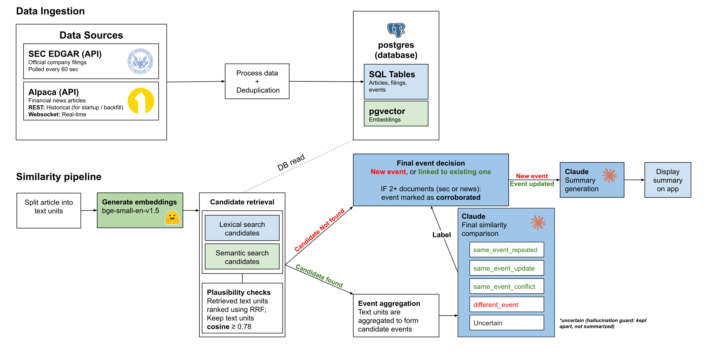

# StockEvent Lens: system code

StockEvent Lens collects **SEC EDGAR 8-K filings** and **Alpaca news** for **NVIDIA (`NVDA`)** by default, with
11 large-cap companies supported as a scalability test. It groups
articles and filings that report the same real-world occurrence into one **event**, and publishes a short
**summary per event** in which every statement cites a verbatim quote from its sources.



* **Ingestion:** SEC polling (~60 s per company) and the Alpaca WebSocket with REST backfill feed a single writer.
  The writer stores every filing and article revision in PostgreSQL (`stock_news`) and as versioned JSON under
  `output/`.
* **Event grouping** (`SIMILARITY_ENABLED`, on in `.env.example`): local embeddings, then pgvector + full-text
  retrieval, then an LLM comparison. Each new record is labelled `repeated`, `update`, `conflict`, `different` or
  `uncertain` against existing events **before** it is stored.
* **Event summaries** (`SUMMARY_ENABLED`, on in `.env.example`): one cited summary per event. It is validated before
  publication, and a confirmed conflict must show both sides.
* **Web page** (`uv run datasources-dev`): a news feed, a per-browser watchlist, and a story page with a
  timeline. A data-tools page shows collectors, processing activity and raw records.

The whole flow is one **LangGraph** graph (`src/datasources/ingest/graph.py`). This README covers setup, running
and an overview; the full behaviour, formats and design choices are in [REFERENCE.md](REFERENCE.md).

| Folder | What it holds | Docs |
| --- | --- | --- |
| `src/datasources/` | ingestion, storage, grouping (`similarity/`), summaries (`summary/`), API, evaluation runner | this file; detail in [REFERENCE.md](REFERENCE.md) |
| `web/` | the reader page and data tools (static HTML/JS served by FastAPI) | [The page](#the-page) |
| `migrate/` | the PostgreSQL schema as ordered SQL migrations; what each table holds; SQL inspection queries | [migrate/README.md](migrate/README.md), [migrate/summary.md](migrate/summary.md) |
| `populate/` | data loaded into the database (e.g. the evaluation answer key) | [populate/README.md](populate/README.md) |
| `evaluation/` | grouping and summarization evaluations, experiment files, results | [evaluation/README.md](evaluation/README.md), [evaluation/summarization/README.md](evaluation/summarization/README.md) |
| `tests/` | offline, database and opt-in live tests; synthetic fixtures | [Tests](#tests), [tests/fixtures/README.md](tests/fixtures/README.md) |
| `data/` | the coverage list (`ticker_cik_map.json`) and real SEC/Alpaca sample payloads | [REFERENCE.md](REFERENCE.md#company-coverage-and-registration) |

## Quick start

From `SystemCode/`, follow these steps top to bottom. At the end, collectors are ingesting NVIDIA news and
filings while you watch them appear on the web page.

You need [uv](https://docs.astral.sh/uv/), [Docker](https://www.docker.com/products/docker-desktop/), Alpaca API
keys and an Anthropic API key.

### 1. Configure the environment

Copy the example and fill in the values it asks for:

```bash
cp .env.example .env
```

### 2. Start the database

```bash
make db
```

### 3. Install the dependencies

```bash
uv sync --locked --extra local-embeddings
```

### 4. Download the embedding model

```bash
uv run datasources-similarity download-model
```

### 5. Run the application

```bash
uv run datasources-dev
```

Open **http://127.0.0.1:8000**. New articles and filings show up in the feed as they are ingested, grouped and
summarized. Ctrl+C stops everything.

## Setup

### Database

| Component | Version |
| --- | --- |
| PostgreSQL | 13 or newer, tested with 18.6 (`compose.yaml` uses `pgvector/pgvector:pg18`) |
| pgvector | tested with 0.8.6; `migrate` runs `CREATE EXTENSION vector`, which needs a role allowed to create it |

* **Shared Docker database (recommended).**
  * `make db` is idempotent. It starts the container if needed, applies only unrecorded migrations and only new
    or changed populate scripts, and prints both logs.
  * Helpers: `make db-verify` (expect `Result: OK`), `make db-psql`, `make db-down` (keeps the data).
  * `make db FORCE=1` drops and rebuilds the database after asking for its name.
  * If port 5432 is taken, set `PGPORT=5433` in `.env`.
* **Own PostgreSQL server.** Set `PGHOST`, `PGPORT`, `PGDATABASE`, `PGUSER` and `PGPASSWORD` in `.env` to point at
  it and create the database. Then build the schema with `uv run datasources-db migrate` (preview first with
  `--dry-run`) and check it with `uv run datasources-db verify`.

Migration rules and the schema are documented in [migrate/README.md](migrate/README.md).

### Configuration

All settings live in `.env`, copied from [.env.example](.env.example), where each one is documented with its
default. Never commit `.env`.

**Fill in:**

| Key | Value |
| --- | --- |
| `ALPACA_API_KEY`, `ALPACA_SECRET_KEY` | your Alpaca keys (news) |
| `SEC_USER_AGENT` | `AppName you@example.com` (required by SEC fair access) |
| `ANTHROPIC_API_KEY` | needed for event grouping and summaries |
| `PGPASSWORD` | any value for the Docker database (it becomes the container's password) |

**Common switches:**

| Setting | Default | Change it to |
| --- | --- | --- |
| `INGEST_SYMBOLS` | `NVDA` | the 11-company list (commented line), the scalability test. Run `uv run datasources-db register-companies` first; see [REFERENCE.md](REFERENCE.md#company-coverage-and-registration). |
| `SIMILARITY_ENABLED` | `true` | `false`: store news without grouping (no paid calls) |
| `SUMMARY_ENABLED` | `true` | `false`: group without writing summaries |
| `SIMILARITY_COMPARISON_BACKEND` | `anthropic` | `mock`: offline plumbing check; never links anything |
| `DATASOURCES_DB_ENABLED` | `true` | `false`: write records to `output/` only, no database |
| `ALPACA_AUTH_MODE` | `trading` | `broker`: OAuth2 client credentials (implemented, not tried on a live Broker account) |

`uv run datasources-similarity check` and `uv run datasources-summary check` validate the setup without writing or
calling a model. Local models (e.g. Qwen2.5-7B) are used only in [evaluation/](evaluation/README.md).

## Running

### `datasources-dev`

The launcher runs three services and prefixes their log lines:

| Service | What it does |
| --- | --- |
| `[web]` | FastAPI serving the page and a read-only API on 127.0.0.1. It never starts collectors or calls a model. |
| `[ingest]` | The worker, `datasources-ingest run`: Alpaca WebSocket with REST recovery, SEC polling, plus grouping and summaries inline when enabled. |
| `[summary]` | The startup summary catch-up, once per start. It summarizes recent events (last `SUMMARY_STARTUP_CATCHUP_DAYS`, default 3) that lack a current summary, capped at `SUMMARY_STARTUP_CATCHUP_MAX_REQUESTS` (10), then exits. |

Before starting, the launcher checks configuration, database, schema, port and locks, and prints whether paid
calls are possible. It never migrates, installs or backfills. When something is missing, it names the fixing
command and stops.

| Option | Effect |
| --- | --- |
| `--check` | run the startup checks and print the summary; start nothing |
| `--no-collectors` | web page and API only (plus the summary catch-up when it is on) |
| `--no-sec` / `--no-alpaca` | leave one collector out |
| `--port 8001` | serve on another port |

* **One worker per output directory** (`output/state/ingest.lock`) and **one graph writer per database partition**
  (a PostgreSQL advisory lock). Stop the worker before `datasources-similarity backfill`/`retry`.
* **Live-only mode** (`INGEST_LIVE_ONLY=true`) collects only what is published after each startup: no backfill,
  no recovery, and saved cursors are left untouched. Switching it off resumes normal recovery from the saved state.
* **Shutdown:** Ctrl+C once lets the worker finish its current record, and queued work stays retryable. A second
  Ctrl+C stops it immediately. The worker heartbeat (`output/state/worker_status.json`) drives the collector
  status on the page.

### Model calls and cost

Page views and API reads never call a model. Paid calls happen only in the worker (for records it ingests) and in
the startup catch-up.

* Per record, grouping makes up to `SIMILARITY_LLM_MAX_CALLS_PER_RECORD` (3) comparison calls and summaries up to
  `SUMMARY_MAX_REQUESTS_PER_RUN` (5) calls, each retried up to 2 times by the SDK. The worst case is
  **24 HTTP requests per record**. Typical: one summary request for a new event, or one comparison plus one summary.
* **The worker has no run-wide cap.** After a long break, Alpaca recovery alone can bring up to 40 pages of
  50 articles. Measure with the bounded live test before enabling paid steps.
* Deferred work is not rescheduled while running. Use `uv run datasources-similarity retry` (worker stopped) or
  `uv run datasources-summary retry --confirm-paid-calls --max-model-attempts N`.

### Bounded live test

`datasources-ingest bounded-run` pushes a small, explicit number of **real** records through grouping and
summaries, with a hard cap on HTTP requests to the model API (SDK retries included). Money is not capped: token
usage is reported. Without `--confirm-paid-calls` it only prints the plan.

```powershell
uv run datasources-ingest bounded-run --source stored  --max-records 2 --max-model-attempts 6 --confirm-paid-calls
uv run datasources-ingest bounded-run --source collect --max-records 3 --max-model-attempts 10 --confirm-paid-calls
```

The report is written to `output/bounded-runs/<run id>/report.json` (stop reason, per-record results, attempts,
tokens). Running the same command again continues where it stopped, without repeating model calls.

### Troubleshooting

| Symptom | Cause and fix |
| --- | --- |
| The page shows another database's data, or none | A `PG*` variable set in this terminal (e.g. for tests) wins over `.env`. `uv run datasources-db check` prints the database reached. Open a new terminal or `Remove-Item Env:PGDATABASE`. |
| `migrate` refuses: base schema "not recorded" | Existing database: review `migrate --dry-run`, then `migrate --adopt-baseline`. |
| `migrate` refuses: base schema "does not match" | Listed objects are missing or different; nothing was changed. Fix them or start from an empty database. |
| `migrate` refuses: "an applied migration was edited" | Restore the file (`git checkout -- <file>`) and put the change in a new migration. |
| "another process is writing grouping results" | A worker, `backfill`/`retry` or bounded run holds the graph-writer lock. Stop it first. |
| "port 8000 ... already in use" | Stop the other server or use `--port 8001`. |
| Worker "was not ready within 180 s" | Usually the embedding model is not downloaded (`datasources-similarity download-model`) or the database is slow. |
| Bounded run stopped with `attempt_budget` | Expected: the cap is used up. Run again with a new cap. |
| Summary "held by another lease" | A run stopped mid-summary; the lease expires after `SUMMARY_LEASE_MINUTES` (10). |

### Commands

Every CLI command and Make shortcut is listed in [REFERENCE.md](REFERENCE.md#command-reference).

## How it works

The pipeline diagram at the top shows the parts. This is what happens to **one** incoming article or filing:

| When… | Then… | AI call? |
| --- | --- | --- |
| no similar coverage of the same company within ±7 days | a new event opens | no |
| the text is an exact copy of a stored article (≥ 400 characters) | linked to that event as a repeat | no |
| similar coverage exists | Claude labels it repeat, update, conflict or different | yes |
| the label has no verbatim evidence on both sides | downgraded to *uncertain*: kept as a pending link, never merged | no |
| a second document (from any source) joins an event | the event becomes *corroborated* | no |
| a model or retrieval call fails | the article is stored anyway (`pending`) and retried later | no |
| an event is new or gets an update | a summary is written, then validated; invalid output is never published | yes |
| a repeat arrives | the existing summary is kept | no |
| the sources conflict | a review opens and a person decides; no source is declared right | no |

Every step for one record is committed in a single database transaction. The step-by-step graph is in
[REFERENCE.md](REFERENCE.md#processing-graph).

### Key design choices

| Part | Choice | Why |
| --- | --- | --- |
| Sources | SEC EDGAR 8-K / 8-K/A filings and Alpaca news (WebSocket, plus REST backfill after every reconnect) | official filings and fast news, with no gap after a disconnect |
| Duplicates | tracked by source identity only (`sec_edgar:<cik>:<accession>`, `alpaca:<id>`); a changed payload becomes a new revision | semantic similarity never deletes a record; it only links records into events |
| Storage | one transaction per record, with no transaction held open during model calls | a crash never leaves half a record behind |
| Text units | articles split at paragraphs and sentences, filings at `Item x.xx` headings; every unit keeps its exact source spans | quotes can be traced back to the source text |
| Retrieval | [`bge-small-en-v1.5`](https://huggingface.co/BAAI/bge-small-en-v1.5) embeddings and PostgreSQL full-text search, fused with reciprocal rank fusion, same company, ±7 days, cosine ≥ 0.78 | a cheap shortlist, so only plausible pairs cost a model call |
| Comparison | Claude labels each pair: repeat, update, conflict, different or uncertain | one structured decision per pair |
| Evidence | every quote must occur verbatim in its passage; a same-event label without evidence on both sides becomes `uncertain` | an invented link can never merge two events |
| Resolution | no transitive merging (A~B and B~C never joins A and C) | one bad link cannot chain events together |
| Summaries | every statement cites verbatim quotes, every number appears in the cited text, and advice phrasing is rejected; invalid output is never published | summaries can be traced to their sources (traceability, not truth) |
| Versions | old summaries and citations are kept and never changed; an unchanged input makes no model call | history stays auditable and repeats cost nothing |
| Conflicts | a person reviews them (`datasources-summary review`) and no source is declared right | the system reports a disagreement, it does not settle it |
| Failures | a failed model or retrieval call stores the record as `pending` and retries it (`failed` after 5 attempts) | ingestion never stops because a model is down |

The full detail of each part (ingestion, grouping, summaries) is in [REFERENCE.md](REFERENCE.md).

### The page

* **News feed** (`/`): all companies, one company, or a watchlist saved in this browser.
  * **Search and filters:** text search, a time window (24 h, 7 days, 30 days or custom dates), *With SEC filings*
    and *Sources disagree*. The server applies them before paging.
  * **Cards:** the AI summary, the latest substantive update, the 8-K items of a filing in plain words, a conflict
    notice with *Compare the claims*, and **Sources (N)** with the quote behind each statement.
  * Stories are grouped by day, and *New* / *Updated* mark what changed since your last visit (this browser only).
  * The feed refreshes every 20 s. A guided **Tour** opens on the first visit and from the header.
* **Story page** (`/events/<id>`): the latest summary, its sources, and a timeline built from stored records.
* **Data tools** (`/tools.html`): collector status, live processing activity, stored records and a source explorer.

The read-only API endpoints are listed in [REFERENCE.md](REFERENCE.md#read-api).

## Evaluation

* **Event grouping:** 125 labelled test articles in 25 batches of 5, scored with pairwise F1 (grouping) and macro-F1
  (labels). Swap the model with one experiment file. See [evaluation/README.md](evaluation/README.md).
* **Summaries:** mechanical checks plus a human score sheet. See
  [evaluation/summarization/README.md](evaluation/summarization/README.md).

Event grouping, all 25 batches. "Retrieval" is what each run used: candidate events shown to the model /
`SIMILARITY_LEXICAL_PLAUSIBLE_RANK`.

| Comparator | Retrieval | Grouping F1 | Label macro F1 | Label accuracy | `uncertain` | Model calls |
| --- | --- | --- | --- | --- | --- | --- |
| Claude Opus 5.5 (low effort) | 6 / 3 | **0.947** | **0.920** | **0.92** | 0 | 101 |
| Gemini 3.8 Flash | 3 / 0 | 0.940 | 0.889 | 0.88 | 2 | 77 |
| Claude Sonnet 5.5 | 3 / 0 | 0.925 | 0.869 | 0.87 | 0 | 79 |
| Claude Haiku 5.5 | 3 / 0 | 0.859 | 0.806 | 0.80 | 2 | 83 |
| Qwen2.5-7B (local) | 6 / 3 | 0.643 | 0.453 | 0.46 | 17 | 132 |
| Rule baseline (always "repeat") | 6 / 3 | 0.735 | 0.102 | 0.25 | 0 | 0 |

* No LLM merged two different events (grouping precision 1.0). The models differ in recall: they miss pairs that
  belong together.
* The rule baseline scores well on grouping because it links every candidate, at a precision of 0.60. Its label
  score shows that it cannot tell the labels apart.
* `update` is the hardest label for every model (F1 0.83 for Opus, 0.78 for Gemini, 0.72 for Sonnet, 0.62 for Haiku).
  The same articles trip all of them: follow-ups that score below the 0.78 similarity filter never reach the model,
  next-day follow-ups are split off as new events, and reversed plans are labelled `update`, as the prompt asks.
* There are about 25 articles per label, so differences under roughly 15 points may be noise.

Summaries (stage 2), not scored against an answer key:

* **Local models** (125 test articles, grouping by the model): Qwen2.5-7B published 7 of 52 event summaries (13.5%);
  the rest failed validation or errored. Qwen3-8B published 44 of 77 (57.1%), with 84% of citations verified, and every
  update article (15 events) and conflict article (9 events) cited in its event's summary.
* **Direct prompting** (Gemini, reading each complete batch with no retrieval, filter or passage limit): its 50 event
  summaries kept the update and flagged the conflict in all 25 batches, by its own checklist (spot-checked on batches
  1 and 12). This is qualitative: the model knew the batch structure.

Raw results: `evaluation/consolidation/results/` (`2026-11-06_1007_claude-opus-5-5-low`, `gemini_125_completed`,
`2026-10-23_1818_claude-sonnet-5-5`, `2026-10-23_1902_haiku-sonnet-settings`, `2026-11-05_1519_local-qwen2.5-7b`,
`2026-11-05_1354_baseline-rule`) and `evaluation/summarization/results/`. The Gemini error analysis and per-batch
notes are in `Miscellaneous/Report/` at the repository root.

## Tests

| Tests | Set first | Run |
| --- | --- | --- |
| Offline (fixtures and a mocked network) | nothing | `uv run pytest` |
| With the database | `PGDATABASE` = a test database name, e.g. `stock_news_mytest` | `uv run pytest` |
| Live, opt-in (real SEC and Alpaca, needs `.env`) | `RUN_LIVE_TESTS` = `1` | `uv run pytest -m live` |

* **Set these variables in a separate terminal used only for tests.** A `PGDATABASE` set there overrides `.env` for
  everything started from that terminal.
* Database tests refuse any database whose name lacks `test`, a protected name, or one holding live documents.
  They delete only the sample rows they wrote.
* Coverage spans:
  * ingestion (SEC parsing and extraction, retries, ledger crash safety, REST/WebSocket duplicates);
  * storage (round trip, revisions, rollback);
  * migrations (fresh build, adoption, checksums);
  * grouping (the real compiled graph with a scripted model);
  * summaries (routing, validation, versions, reviews);
  * the bounded run (attempt caps against a fake network);
  * the page (watchlist, timeline, conflict notice, headless-browser tests).
* These are workflow tests with scripted models: they prove orchestration, not model quality. Quality is measured
  in [evaluation/](evaluation/README.md).

## Limitations

* SEC extraction covers the primary 8-K document only; exhibits such as EX-99.1 press releases are linked, not
  extracted.
* Alpaca and SEC recovery are bounded (72 h / 40 pages; `SEC_RECOVERY_MAX_DAYS`, `SEC_MAX_HISTORICAL_FILES`).
* Only registered tickers are linked: `GOOG` or preferred-share tickers are not.
* Collecting all 11 companies is tested offline but has not been measured live (Alpaca symbol limits, article
  volume).
* Grouping defaults (7-day window, 0.78 cosine, 3 candidate events) are experimental starting points calibrated on
  58 NVIDIA revisions.
* Events are never merged automatically. An 8-K with two Items about one deal starts as two events.
* Lexical ranking has no corpus-level IDF. Semantic retrieval is an exact scan, with no ANN index yet.
* Inline model calls bound ingestion throughput. The worker has no run-wide cost cap.
* Summaries are validated for **traceability, not truth**. The figures check is strict ("Q1" vs "first quarter").
  English only.
* Queued summary work runs only when a later record touches the event, at the next start, or via `summary retry`.
* The watchlist is per browser; there are no accounts.

## References

[SEC EDGAR APIs](https://www.sec.gov/search-filings/edgar-application-programming-interfaces) ·
[SEC fair access](https://www.sec.gov/about/developer-resources) ·
[Alpaca news REST](https://docs.alpaca.markets/us/reference/news-3) ·
[Alpaca news WebSocket](https://docs.alpaca.markets/us/docs/streaming-real-time-news) ·
[LangGraph](https://docs.langchain.com/oss/python/langgraph/overview) ·
[uv](https://docs.astral.sh/uv/concepts/projects/dependencies/) ·
[bge-small-en-v1.5](https://huggingface.co/BAAI/bge-small-en-v1.5) ·
[pgvector](https://github.com/pgvector/pgvector) ·
[PostgreSQL full-text search](https://www.postgresql.org/docs/current/textsearch.html) ·
[Reciprocal rank fusion (Cormack et al., 2009)](https://plg.uwaterloo.ca/~gvcormac/cormacksigir09-rrf.pdf) ·
[Claude structured outputs](https://platform.claude.com/docs/en/build-with-claude/structured-outputs)
